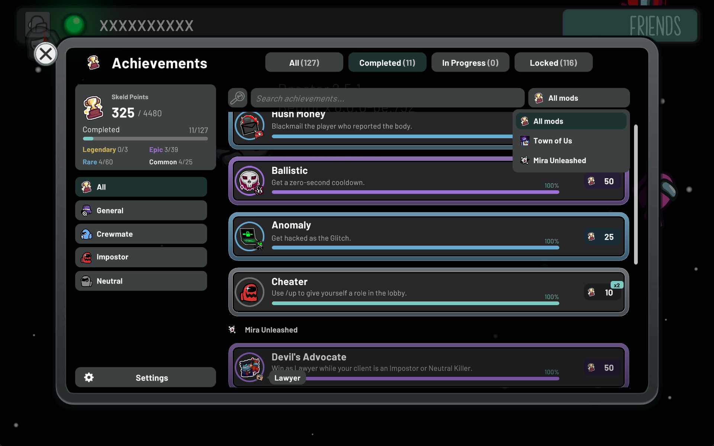
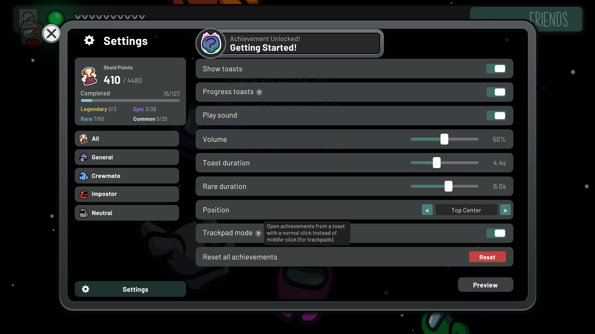

<div align="center">

# Achievements API

An Among Us API for registering mod achievements, tracking progress, and displaying in-game achievement menus and toast notifications.

[](LICENSE)
[](https://dotnet.microsoft.com)
[](https://discord.gg/RJyNm9UaT7)

</div>

## Features

- Property-based or runtime achievement registration
- Progress counters with persistent state
- Hidden achievements, rarity tiers, and Skeld Points
- Achievement tags for filtering and searching (e.g. by role or modifier)
- In-game menu with categories, filters, details, and toast settings
- Animated toast notifications with sound and swipe-to-dismiss
- Mouse, keyboard, and controller support
- Encrypted, signed save data

## Screenshots

<div align="center">
  
  <br />
  <sub>Achievement menu</sub>
  <br /><br />
  <table>
    <tr>
      <td align="center">
        <br />
        <sub>Progress notification</sub>
      </td>
      <td align="center">
        <br />
        <sub>Toast settings and preview</sub>
      </td>
    </tr>
  </table>
</div>

## Quick start

Reference `AchievementsAPI` from your mod and subclass `AchievementsTab`. Achievements are declared as properties and discovered automatically when your plugin loads:

```csharp
using Reactor.Localization.Utilities;

[BepInAutoPlugin]
[BepInDependency(AchievementsAPIPlugin.Id)]
public class MyPlugin : BasePlugin
{
    public override void Load() { }
}

public class MyTab : AchievementsTab
{
    private static readonly StringNames TabName = CustomStringName.CreateAndRegister("My Mod");

    public override StringNames Name => TabName;
    public override string IconPath => "MyMod.Resources.Icon.png";

    public BaseAchievement FirstWin { get; set; } =
        new("First Win", "Win a game.", "MyMod.Resources.FirstWin.png", rarity: 1);

    public CountAchievement TenTasks { get; set; } =
        new("Busy Bee", "Complete 10 tasks.", "MyMod.Resources.Tasks.png", 0, 10);
}
```

Unlock with `achievement.Unlock()`; count achievements unlock on their own via `Increment(amount)` once the goal is reached. Keeping the API optional (soft dependency) uses a different pattern; both are covered in the docs.

## Documentation

**[docs/](docs/README.md)** has the full developer documentation:

- [Getting started](docs/getting-started.md): hard vs soft dependencies, first tab
- [Defining achievements](docs/achievements.md): rarity, Skeld Points, hidden achievements, sub-icons, art overrides, tags
- [Tabs and categories](docs/tabs-and-categories.md): discovery, mod grouping, shared categories
- [Localization](docs/localization.md): `StringNames` and translation packs
- [Game events](docs/game-events.md): reset triggers, progress persistence, deferred toasts
- [Menu and toasts](docs/menu-and-toasts.md): the player UI and its configuration
- [Storage](docs/storage.md): save file format and encryption
- [Building and internals](docs/building.md): project layout, CI, the developer plugin

## Build

The solution targets .NET 6: `dotnet build AchievementsAPI.sln`. CI runs `build.cake` and uploads `AchievementsAPI.dll` as an artifact; pushing a `vX.Y.Z` tag publishes a GitHub release (see [docs/building.md](docs/building.md#releases)).

## Reactor vs VentFramework builds

The same source builds two flavors of the plugin, both named `AchievementsAPI.dll` with the same BepInEx plugin id — install only one:

- **Reactor** (`AchievementsAPI/AchievementsAPI.csproj`, package `CloneC.AchievementsAPI`): the standard build; requires the Reactor mod.
- **VentFramework** (`AchievementsAPI.VF/AchievementsAPI.VF.csproj`, package `CloneC.AchievementsAPI.VentFramework`): the same feature set against VentFramework (`com.discussions.VentLib`); no Reactor dependency.

Set `-p:AmongUs=` / `-p:AmongUsVF=` to copy the respective DLL into a game install on build. See [docs/building.md](docs/building.md#two-builds-reactor--ventframework).

## Credits

- **satire ([rewalo](https://github.com/rewalo))**: UI and toast design/implementation, animations, and optimizations
- **[atony](https://github.com/AtonyGit)**: UI design and achievement-system improvements
- **[pix](https://github.com/wanderingpix)**: Additional help

## Support

Join the [Discord server](https://discord.gg/RJyNm9UaT7) for support and discussion.

> [!NOTE]
> This mod is not affiliated with or endorsed by Innersloth LLC. Portions of the materials are property of Innersloth LLC. © Innersloth LLC.
